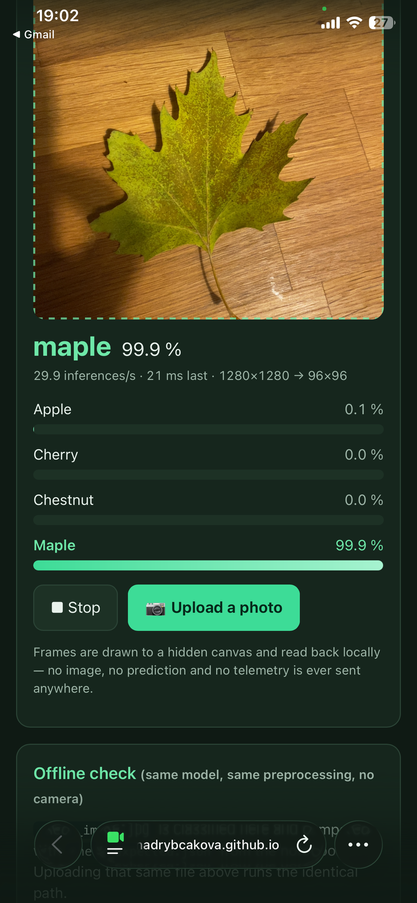
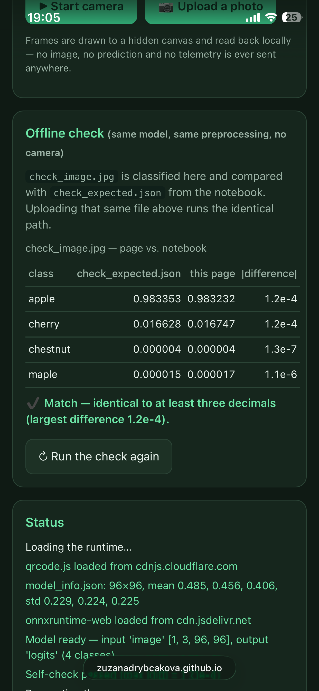

REVIEW TASK 2 - Zuzana Drybcakova

1) IT RUNS ON YOUR PHONE

The web application was successfully tested and executed on an iPhone using the Safari web browser, as shown in the screenshot above. 

2) THE SAME NUMBERS AS THE NOTEBOOK: 

All output values match the notebook predictions to at least 3 decimal places (maximum observed difference is 1.2x10^-4).

3) THE PREPROCESSING MATCHES YOUR MODEL

The preprocessing pipeline is implemented in index.html inside the preprocess(source, sourceW, sourceH) function: 

Center crop - lines 433–435 calculate the side length and top-left offsets to extract the central square. 

Resize - lines 442–464 handle the resize to target dimensions (96x96 as defined by INFO.input_size). For larger source inputs, it performs a two-step downsampling using an intermediate cropCanvas before rendering onto srcCanvas via drawImage.
 
Division by 255 and standardization - lines 466 and 474–479 read the raw RGBA pixels and normalize each channel using (x−mean)/std. 

Channel order (NCHW) - lines 469–479 flatten into three contiguous planar blocks (size W×H each) in planar order: R at offset 0, G at offset plane, and B at offset 2 * plane, matching the NCHW tensor format expected by ONNX Runtime. 

4) NOTHING LEAVES THE PHONE

Inspecting the Network tab confirms that camera frames and images are never transmitted to any external backend. All operations run entirely on-device: frames are captured via getUserMedia(), drawn onto an offscreen HTML5 <canvas>, and processed locally by ONNX Runtime Web using WebAssembly (WASM). No telemetry, photos, or predictions leave the device.

The page dynamically injects its client-side dependencies via runtime script loading:

https://cdn.jsdelivr.net/npm/onnxruntime-web@1.21.0/dist/ort.min.js (with fallbacks on cdn.jsdelivr.net / cdnjs.cloudflare.com): Loaded to provide the ONNX Runtime Web engine, which subsequently fetches its associated .wasm runtime binaries from the same CDN origin.

https://cdnjs.cloudflare.com/ajax/libs/qrcodejs/1.0.0/qrcode.min.js (with a jsDelivr fallback): Loaded to render the client-side QR code directly in the browser canvas without using any third-party image generation APIs.